# agy-agents-harness

> Autonomous Multi-Agent Council Runtime with Engine-Level Policy Interception, Semantic Grounding, and Fail-Closed Evaluation Gates.

[](https://antigravity.google)
[](https://python.org)
[](LICENSE)
[](#empirical-verification-matrix)

---

## Overview

Existing Multi-Agent Debate implementations suffer from four critical failure modes when deployed without runtime enforcement:

1. **Pseudo-Math & Academic Slop**: Debaters invent arbitrary scoring formulas (e.g. $1.5|E| + 6C$) and self-reported certainty statistics (*"95% confident"*, *"80% cognitive energy"*) that disguise subjective opinions as rigorous math.
2. **Facade Citations & Ungrounded Metrics**: Agents cite real file paths or configurations to pass superficial validators while asserting unsubstantiated throughput numbers (*"+300% read capacity"*, *"85% CPU cap"*).
3. **Manufactured Consensus**: Debaters flatten genuine architectural tensions (e.g. linearizability vs. availability) into unanimous votes (*"3-0 consensus"*) without documenting trade-off matrices.
4. **Unsandboxed Side Effects**: Agents execute destructive or external operations without host OS confinement.

**`agy-agents-harness`** solves these failure modes by combining **Antigravity engine-level lifecycle hooks (`PreToolUse`)**, **semantic evidence validation**, **provenance quarantine**, and an **external fail-closed evaluation gate**.

---

## Architecture & Lifecycle

```mermaid
flowchart TD
    subgraph Engine_Boundary["Antigravity Engine & Runtime Boundary"]
        ToolCall["Agent Tool Call (write_to_file, run_command)"] --> PreHook["PreToolUse Hook (live_pre_tool_hook.py)"]
        PreHook -->|Unauthorized Path /tmp| DenyBlock["HARD DENY (Zero Disk Side-Effects)"]
        PreHook -->|Authorized Workspace| AllowExec["OS Tool Dispatch"]
    end

    subgraph Council_Workflow["Multi-Agent Council Deliberation"]
        Problem["Problem Statement"] --> Debaters["Concurrent Debaters (debate-participant)"]
        Debaters --> Receipts["Evidence Receipts & Citations"]
        Receipts --> Quarantine["Provenance Quarantine"]
        Quarantine --> SemanticVal["Semantic Evidence Validator"]
        
        SemanticVal -->|Failed Citation| BlockGate["RATIFICATION_BLOCKED"]
        SemanticVal -->|Verified Grounding| EvalGate["Independent Evaluation Gate"]
        
        EvalGate --> AntiSlop["Anti-Slop & Pseudo-Math Audit"]
        EvalGate --> QuantAudit["Quantitative Completeness Audit"]
        EvalGate --> DissentAudit["Dissent Preservation Audit"]
        
        AntiSlop & QuantAudit & DissentAudit --> GateDecision{"All Gates Passed?"}
        GateDecision -->|No| BlockGate
        GateDecision -->|Yes| Ratified["RATIFIED & RELEASED"]
    end
```



---

## The Three Enforceable Contracts

### 1. The Evidence Contract
- **Semantic Grounding**: Every consequential claim must cite verifiable source lines (`[FILE:LINE]`, CLI logs, or RFCs). Citing unrelated files to pass superficial string checks is detected and rejected via semantic keyword alignment.
- **Provenance Quarantine**: Debater claims whose citations fail validation are quarantined and cannot serve as backing evidence for quantitative synthesis metrics.
- **Ungrounded Metrics Gate**: Assertions containing metrics (e.g., `+300%`, `85% CPU`, `<5ms`) in the final synthesis that lack grounded backing receipts trigger an immediate `UNGROUNDED_SYNTHESIS_METRIC` block.
- **Falsification Condition**: Every technical recommendation must specify explicit falsification triggers (*"This proposal fails if condition X holds"*).

### 2. The Execution Contract
- **Engine-Level Hook Confinement**: All tool calls are intercepted before OS execution via `hooks.json` (`PreToolUse`). Out-of-workspace writes or dangerous commands are blocked with zero bytes written.
- **Branch Worktree Isolation**: Subagents performing code modifications are spawned with `Workspace: "branch"` (Git worktree isolation) to prevent unreviewed modifications from polluting the main working tree.
- **Process Group Termination**: Multi-process command executions are bound to process groups (`os.killpg`) to guarantee clean teardown and prevent orphan process leaks.

### 3. The Learning Contract
- **Versioned Lessons**: Decisions persisted to durable memory record timestamps, scope of validity, empirical grounding, and explicit supersession conditions to prevent outdated decisions from hardening into permanent false assumptions.

---

## Empirical Verification Matrix

The test suite runs against the actual Antigravity engine and local operating system boundary without mocks.

| Verification Scenario | Status | Verified Mechanism | Reproduction Command |
| :--- | :---: | :--- | :--- |
| **Engine `PreToolUse` Hook Interception** | **PASS** | Tool calls are intercepted synchronously in real time before execution (51–53 µs delta). | Telemetry logged in `test_harness/council_runtime/live_hook.log` |
| **Bypass Resistance & Zero Side Effects** | **PASS** | Write to `/tmp/unauthorized_test_escape.txt` hard-denied by engine. 0 bytes written to disk. | `agy --dangerously-skip-permissions -p "Write to /tmp/unauthorized_test_escape.txt"` |
| **Provenance Quarantine & Evidence Audit** | **PASS** | Quarantines unverified citations; blocks synthesis injecting ungrounded `+300%` and `85% CPU`. | `python3 test_harness/council_runtime/test_live_council_gate.py` |
| **Live Multi-Agent Debate Subagents** | **PASS** | Invoked concurrent live subagents in engine; verified structured evidence receipts and boundary conditions. | `python3 test_harness/council_runtime/test_live_council_gate.py` |
| **Adversarial Regression Benchmark** | **PASS** | Baseline Council permits 4 defects; Enforced Council blocks Turn 1 and ratifies Turn 2 after verified revisions. | `python3 test_harness/council_runtime/regression_suite.py` |

---

## Directory Structure

```text
agy-agents-harness/
├── agents/                               # Production Agent Specifications
│   ├── council-moderator.md              # Council Moderator prompt and tool policy
│   └── debate-participant.md             # Debater agent with Evidence Receipt contract
├── config/
│   └── hooks.json.example                # Antigravity PreToolUse hook configuration
├── test_harness/                         # Independent Evaluation Layer
│   ├── evidence_validator.py             # File and line slice validator
│   ├── execution_safety_validator.py     # Sandbox confinement and timeout validator
│   ├── evaluation_gate.py                # External audit layer (Anti-Slop, Quantitative metrics)
│   ├── run_all_tests.py                  # Initial acceptance test suite (5/5 PASS)
│   ├── v2/                               # Adversarial V2 Test Suite
│   │   ├── semantic_evidence_validator.py# Semantic keyword and citation alignment
│   │   ├── path_confinement_validator.py # Symlink race and path escape defense
│   │   ├── process_group_runner.py       # Descendant process tree cleanup
│   │   ├── semantic_evaluation_gate.py   # Sneaky consensus and dissent matrix audit
│   │   └── test_adversarial_v2.py        # V2 test runner (5/5 PASS)
│   └── council_runtime/                  # Live Runtime Enforcement
│       ├── council_orchestrator.py       # Fail-Closed Council Orchestrator with Quarantine
│       ├── runtime_interceptor.py        # Engine tool interceptor
│       ├── live_pre_tool_hook.py         # Production PreToolUse lifecycle hook script
│       ├── test_live_council_gate.py     # Live multi-agent gate verification (2/2 PASS)
│       └── regression_suite.py           # End-to-end regression benchmark (4/4 PASS)
├── LEDGER.md                             # Reverse-chronological project audit log
├── LICENSE                               # Apache 2.0
└── README.md
```

---

## Quickstart

### 1. Prerequisites
- Python 3.10+
- Google Antigravity 2.0 (`agy`) CLI or Antigravity IDE

### 2. Running Test Suites

Execute the live council verification suite:
```bash
python3 test_harness/council_runtime/test_live_council_gate.py
```

Execute the full regression benchmark:
```bash
python3 test_harness/council_runtime/regression_suite.py
```

Execute the adversarial V2 suite:
```bash
python3 test_harness/v2/test_adversarial_v2.py
```

Execute the core acceptance tests:
```bash
python3 test_harness/run_all_tests.py
```

### 3. Activating Engine-Level Lifecycle Hooks

To enforce workspace boundaries and block unauthorized tool calls in your Antigravity environment, copy `config/hooks.json.example` into your Antigravity customization directory (e.g. `~/.gemini/config/hooks.json`):

```json
{
  "council-interceptor": {
    "PreToolUse": [
      {
        "matcher": "*",
        "hooks": [
          {
            "type": "command",
            "command": "/absolute/path/to/test_harness/council_runtime/live_pre_tool_hook.py"
          }
        ]
      }
    ]
  }
}
```

Ensure `live_pre_tool_hook.py` is executable:
```bash
chmod +x test_harness/council_runtime/live_pre_tool_hook.py
```

---

## Contributing & License

Contributions are welcome. Please ensure that any proposed modifications include automated tests runnable via `regression_suite.py`.

Licensed under the [Apache License, Version 2.0](LICENSE).
